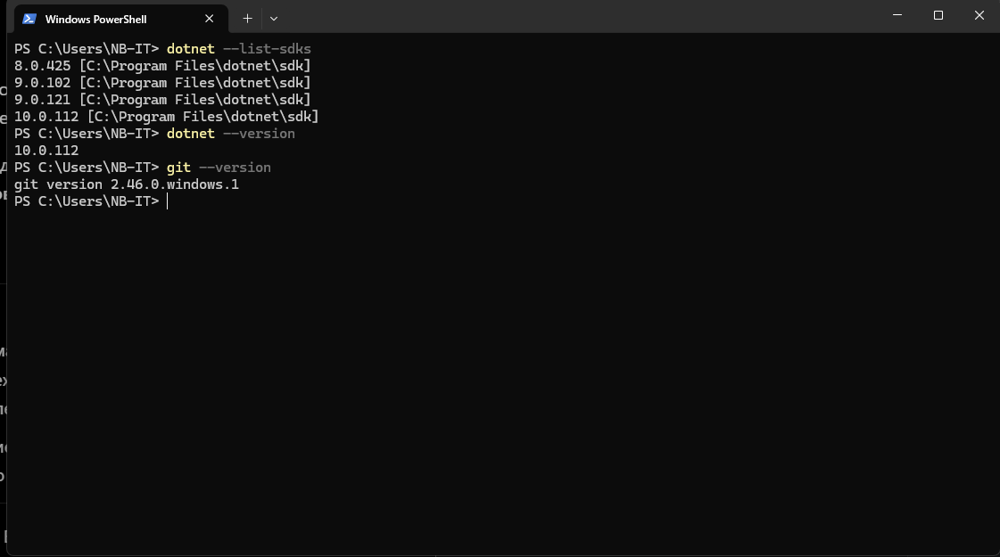
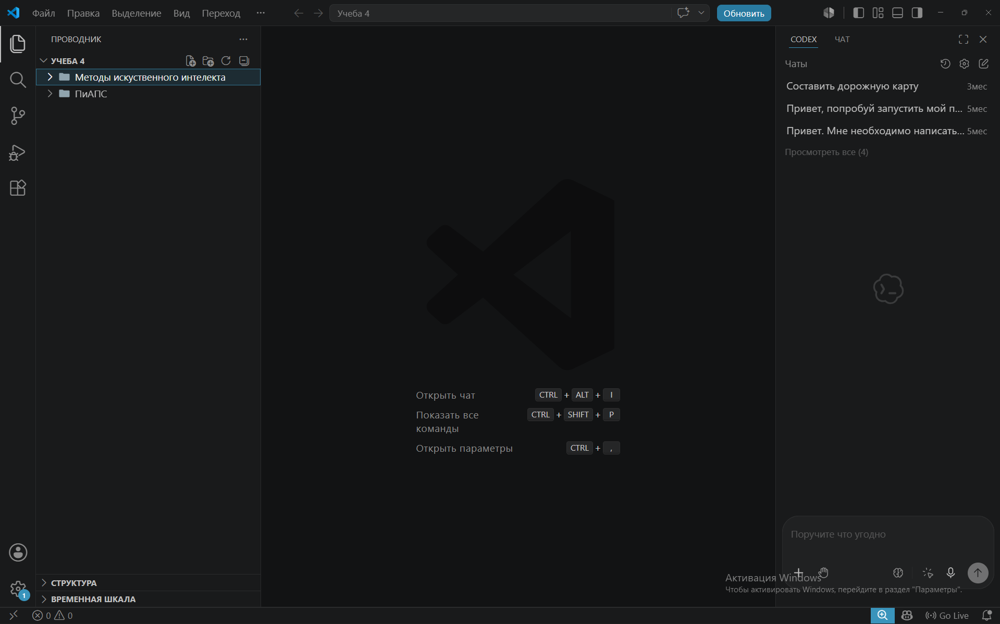
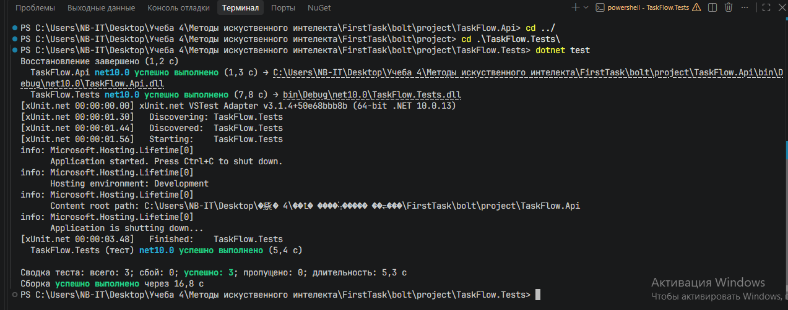
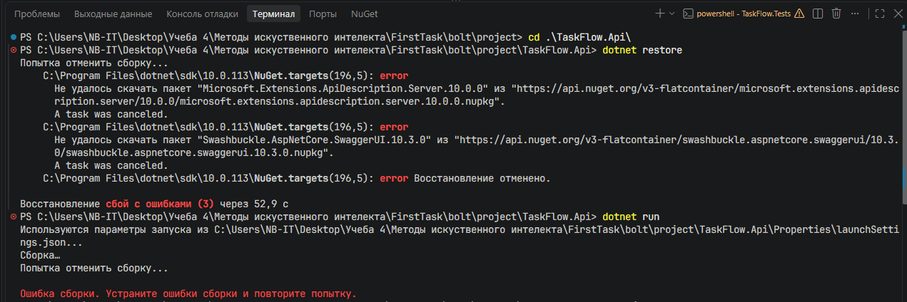
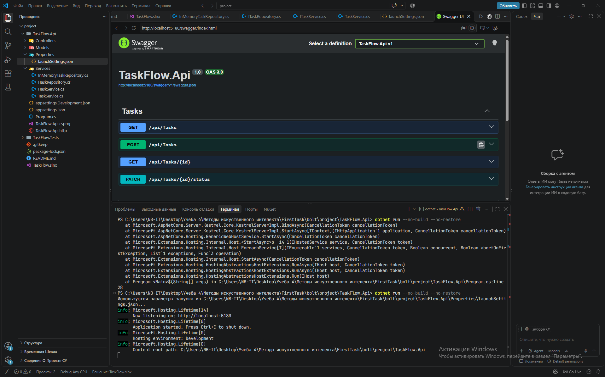
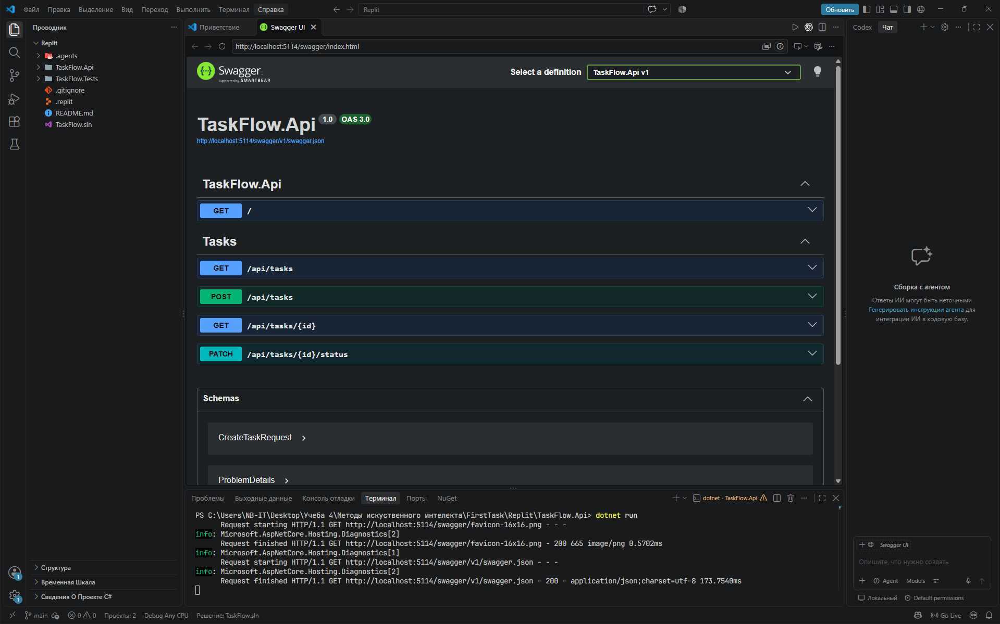
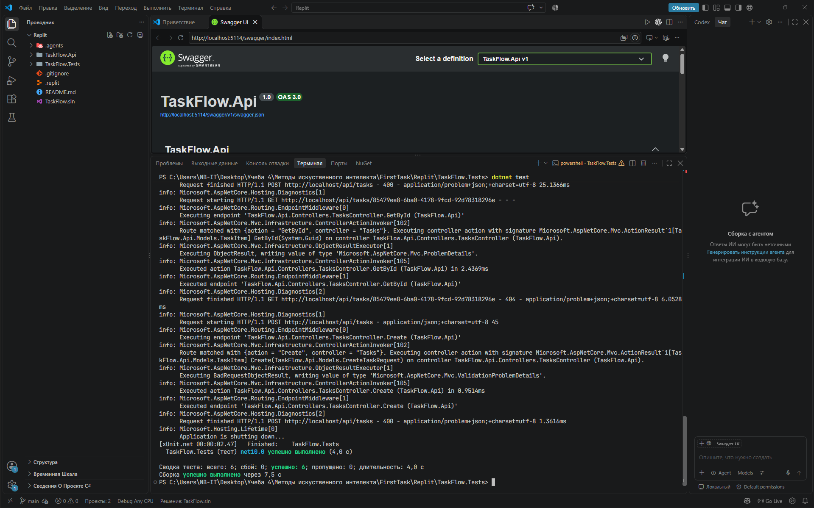

# Домашнее задание № 1

## Сравнительный анализ и настройка AI-инструментов для разработки TaskFlow

**Формат работы:** сравнительный анализ и практическое тестирование Cloud- и IDE/CLI-агентов.  
**Рассматриваемая задача:** разработка ASP.NET Core Web API для управления задачами.  
**Выбранный инструмент:** Codex в Visual Studio Code.

## 1. Анализ требований проекта

В качестве учебного проекта выбрано приложение **TaskFlow** для управления личными задачами. В дальнейшей разработке планируется реализовать полноценное веб-приложение с авторизацией, хранением данных в PostgreSQL и пользовательским интерфейсом. Разработка организована по принципу _Backend-first_: сначала формируется API и бизнес-логика, затем к ним подключается Frontend.

Основной технологический стек: **C#, .NET 10, ASP.NET Core Web API, PostgreSQL, Entity Framework Core**. Для автоматических тестов используется **xUnit**, для документирования HTTP-методов — **Swagger/OpenAPI**. PostgreSQL и EF Core относятся к следующему этапу проекта; в сравнительном испытании они сознательно не использовались.

Для проверки AI-агентов выбрана ограниченная задача — создание небольшого REST API с временным потокобезопасным хранилищем в памяти. Такой объём позволяет проверить не только генерацию отдельных функций, но и создание решения с несколькими проектами, контроллерами, сервисами и тестами.

### 1.1. Требования к инструменту

| Параметр                   | Требование TaskFlow                                                                                                                   |
| -------------------------- | ------------------------------------------------------------------------------------------------------------------------------------- |
| Сложность                  | Средняя: несколько взаимосвязанных файлов и проектов, REST API, валидация, тестирование.                                              |
| Контекст проекта           | Чтение и согласованное изменение C#-файлов, проектных настроек, зависимостей и тестов.                                                |
| Доступ к локальным файлам  | Желателен прямой доступ к рабочему каталогу; обязательна возможность получить и продолжить редактировать исходники.                   |
| Проверка работоспособности | Выполнение `dotnet restore`, `dotnet build`, `dotnet test`, просмотр Swagger и HTTP-ответов.                                          |
| Безопасность               | Отсутствие реальных секретов и персональных данных в промптах; контроль доступа к проекту и выполняемых команд.                       |
| Бюджет                     | Использование действующей подписки ChatGPT Plus и бесплатных возможностей других сервисов; новые платные подписки не рассматриваются. |
| Дальнейшая разработка      | Удобная работа с Git, PostgreSQL, миграциями, тестами и последующим Frontend.                                                         |

При подготовке среды использовался ПК под Windows с **.NET SDK 10.0.112**, Git **2.46.0.windows.1** и Visual Studio Code. Установленные SDK и Git показаны на рис. 1.



_Рисунок 1 — Проверка .NET SDK и Git_

## 2. Сравнительный анализ инструментов

Для сравнения выбраны четыре инструмента, соответствующие перечню из задания:

- **IDE/CLI-агенты:** Codex (через расширение Visual Studio Code) и Cursor.
- **Cloud-агенты:** Bolt.new и Replit Agent.

Разница между категориями учитывается отдельно: IDE/CLI-агенты работают с локальным каталогом разработки, а облачные агенты создают или изменяют файлы в собственной удалённой среде. Наличие локального редактора не означает, что AI-модель работает без передачи контекста в облако.

### 2.1. Методика балльной оценки

Каждый критерий оценивается по шкале **1–5 баллов**: 1 — инструмент практически не подходит задаче, 2 — существенные ограничения, 3 — приемлемо с заметными недостатками, 4 — соответствует требованиям с небольшими ограничениями, 5 — наиболее удобное или качественное решение для данного проекта.

Важность критериев различается: для Backend-проекта корректность кода и возможность работать с локальной кодовой базой важнее одного разового замера скорости.

| Критерий из задания                   |      Вес | Что учитывалось                                                                   |
| ------------------------------------- | -------: | --------------------------------------------------------------------------------- |
| Доступ к контексту проекта            |      20% | Доступ к связанным файлам и возможность продолжить работу с решением.             |
| Скорость генерации кода               |      10% | Наблюдаемое общее время выполнения одной задачи.                                  |
| Качество кода                         |      25% | Выполнение требований, валидация, конкурентное обновление, тесты, структура.      |
| Стоимость использования               |      20% | Возможность работать без покупки новой подписки и ограничение бесплатных лимитов. |
| Требования к безопасности данных      |      10% | Управление доступами, разрешениями и передаваемым кодом.                          |
| Удобство интеграции в рабочий процесс |      15% | Работа с локальной IDE, CLI, Git, терминалом, сборкой и экспортом проекта.        |
| **Итого**                             | **100%** |                                                                                   |

Итоговая оценка рассчитана как сумма произведений баллов на соответствующие веса: **S = Σ(балл × вес / 100)**. Баллы характеризуют пригодность сервисов именно для TaskFlow, а не универсальный рейтинг всех моделей.

### 2.2. Сравнительная таблица (1–5 баллов)

| Критерий                     | Codex (IDE/CLI) | Cursor (IDE) | Bolt.new (Cloud) | Replit Agent (Cloud) |
| ---------------------------- | --------------: | -----------: | ---------------: | -------------------: |
| Доступ к контексту проекта   |           **5** |        **5** |                3 |                    3 |
| Скорость генерации           |               2 |            4 |                4 |                **5** |
| Качество кода                |           **4** |            3 |                3 |                **4** |
| Стоимость использования      |           **5** |            4 |                4 |                    4 |
| Безопасность данных          |               4 |            4 |                3 |                    3 |
| Интеграция в рабочий процесс |           **5** |        **5** |                2 |                    3 |
| **Итог без весов (из 30)**   |          **25** |           25 |               19 |                   22 |
| **Итог с весами (из 5)**     |        **4,35** |     **4,10** |         **3,15** |             **3,65** |
| **Место с учётом весов**     |           **1** |        **2** |            **4** |                **3** |

**Пояснение к оценкам.**

**Контекст проекта.** Codex и Cursor получили по 5 баллов, поскольку работали непосредственно с локальными файлами решения .NET и могли изменять классы и конфигурацию. Bolt.new и Replit использовали собственные облачные проекты с возможностью экспорта; это достаточно для учебной задачи, но менее удобно для постоянной локальной разработки.

**Скорость.** Зафиксировано около 18 минут у Codex, около 10 минут у Cursor и Bolt.new и около 6 минут у Replit. Поэтому Replit получил 5 баллов, Cursor и Bolt — по 4, Codex — 2. Замер Codex нельзя считать чистым временем генерации: присутствовали ожидания разрешений и ошибка NuGet `NU1301`. Результаты скорости отражают наблюдаемое время конкретного эксперимента, а не типичную производительность сервисов.

**Качество кода.** Codex и Replit получили по 4 балла. Оба использовали неизменяемую модель задачи и цикл `TryUpdate` для конкурентного изменения статуса; Replit также создал интеграционные тесты HTTP API. Codex проверил три основных сценария тестами сервиса, но не создал интеграционных тестов. Cursor получил 3 балла: архитектура хорошо разделяет хранилище и бизнес-логику, однако обычный enum с `[Required]` не гарантирует отклонение отсутствующего `status`; конкурентное обновление устроено менее удачно. Bolt получил 3 балла: успешно созданы HTTP-тесты и отдельный репозиторий, но обнаружены замечания к обязательности `status` и изменению общего объекта при конкурентных запросах. Сравнение основано на просмотре присланных исходников и результатах запусков; отдельные нагрузочные испытания не проводились.

**Стоимость.** Codex получил 5 баллов, поскольку доступен в рамках уже оплаченной ChatGPT Plus и для испытания не потребовал дополнительной оплаты. Остальные получили по 4: бесплатные возможности оказались достаточными для проверки, но расходуются лимиты запросов, токенов или кредитов. У Codex тоже есть лимиты подписки; отсутствие новых расходов не означает неограниченное использование.

**Безопасность.** Codex и Cursor оценены в 4 балла: есть возможность ограничивать доступ к локальному проекту, а при работе Codex запрашивались подтверждения действий. При этом оба инструмента могут отправлять контекст проекта в удалённые AI-сервисы, поэтому их нельзя считать полностью локальными. Bolt и Replit получили по 3 балла, поскольку разработка велась в облачных средах, а отдельная проверка настроек конфиденциальности не выполнялась. Эти оценки не являются результатом формального аудита информационной безопасности.

**Интеграция.** Codex и Cursor получили 5 баллов благодаря непосредственной работе с VS Code/локальной IDE, файлами, Git и командами .NET. У Replit есть облачный редактор, запуск и экспорт, но для дальнейшей разработки в привычной локальной среде требуется перенос проекта — 3 балла. У Bolt при получении и запуске проекта потребовались экспорт и локальная настройка; интерфейс попытался использовать JavaScript-сценарий с `package.json`, который не относится к C# API, — 2 балла.

### 2.3. Результаты практического испытания

| Показатель                 | Codex                                        | Cursor                                  | Bolt.new                                                | Replit Agent                                                   |
| -------------------------- | -------------------------------------------- | --------------------------------------- | ------------------------------------------------------- | -------------------------------------------------------------- |
| Тип                        | IDE/CLI                                      | IDE                                     | Cloud                                                   | Cloud                                                          |
| Общее время                | ~18 мин\*                                    | ~10 мин                                 | ~10 мин                                                 | ~6 мин                                                         |
| Созданы все 4 API-маршрута | Да                                           | Да                                      | Да                                                      | Да                                                             |
| Сборка                     | Успешно                                      | Успешно                                 | Успешно                                                 | Успешно                                                        |
| Тесты                      | **3/3**                                      | **5/5**                                 | **3/3**                                                 | **6/6**                                                        |
| Проверка Swagger           | Да                                           | Да                                      | Да                                                      | Да                                                             |
| Тип автоматических тестов  | Сервисные                                    | Сервисные                               | Интеграционные HTTP                                     | Интеграционные HTTP                                            |
| Основная сложность         | Сетевая ошибка NuGet, ожидание подтверждений | Существенных сбоев по сообщению не было | Экспорт, отдельный `restore`, запуск вне облачной среды | Исправления конфликтов типов/сериализации в процессе генерации |

\*Время Codex могло увеличиться из-за отсутствия пользователя у компьютера. Значения приблизительные. Количество тестовых случаев не равно количеству уникальных проверяемых функций: у Cursor три варианта пустого названия объединены в параметризованный тест.

По всем четырём инструментам сохранены исходники. Для Bolt и Replit дополнительно предоставлены скриншоты самостоятельного локального запуска и тестирования. Для Codex и Cursor успешная сборка и тестирование указаны по сообщениям агентов и подтверждению при испытании; отдельных снимков полного вывода тестов в приложенном комплекте нет.

## 3. Выбор основного AI-инструмента

Для дальнейшей разработки TaskFlow выбран **Codex в Visual Studio Code**. Суммарная взвешенная оценка составила **4,35 из 5 баллов** — наибольшее значение среди рассмотренных инструментов.

Выбор определили три практических обстоятельства. Во-первых, Codex работает с локальным C#-проектом и может изменять связанные файлы, запускать сборку и тестирование. Во-вторых, в представленном коде корректно обработаны отсутствие обязательного поля статуса и конкурентное обновление задачи. В-третьих, использование не требует покупки дополнительной подписки сверх имеющейся ChatGPT Plus в пределах включённых лимитов.

Альтернативы также рассматриваются как пригодные для разработки, но уступают выбранному варианту по совокупности требований:

- **Cursor** — ближайшая альтернатива. Он выполнил задачу быстрее, а отдельный слой хранения данных хорошо подготовлен к будущему подключению PostgreSQL. В тестовом коде отмечены ошибки в обработке обязательного статуса и особенности конкурентного обновления. Бесплатный доступ ограничен.
- **Replit Agent** — лучшее наблюдаемое время и шесть интеграционных тестов. Подходит для быстрого облачного прототипа, однако для постоянной работы с существующим локальным .NET-репозиторием требуется перенос изменений между средами.
- **Bolt.new** — смог создать работающее C# API и тесты, но вызвал больше сложностей с экспортом и запуском. Его стандартная среда в меньшей степени ориентирована на ASP.NET Core.

Рейтинг не означает, что Codex объективно быстрее или пишет лучший код во всех случаях. В данном сравнении он оказался наиболее подходящим для запланированного способа работы над TaskFlow.

## 4. Настройка рабочего окружения

Для выбранного IDE-агента подготовлено рабочее окружение **Windows + Visual Studio Code + расширение Codex**. Авторизация расширения выполнена через аккаунт ChatGPT с действующей подпиской Plus. Рабочий каталог тестового проекта был открыт отдельно от других учебных файлов, чтобы агент не получил лишний контекст и не изменил посторонние проекты.

Последовательность настройки:

1. Проверена установка .NET SDK 10 и Git (рис. 1).
2. Установлено и открыто расширение Codex в VS Code (рис. 2).
3. Проверена авторизация и доступность интерфейса агента.
4. Создан отдельный рабочий каталог `codex-test` для проверки генерации.
5. Подготовлена задача на создание REST API без внешней базы и авторизации.
6. Проверены создание файлов решения, сборка и автоматические тесты по итогам работы агента.



_Рисунок 2 — Codex в Visual Studio Code_

**MCP (Model Context Protocol)** не подключался: для текущей задачи достаточно доступа к локальным файлам и терминалу. Подключение внешних сервисов на этом этапе не требуется. PostgreSQL также не разворачивался, поскольку по тестовому сценарию использовалось in-memory хранилище.

## 5. Практическое применение выбранного агента

### 5.1. Постановка задачи и промпт

Одно и то же функциональное задание использовалось для сравнения четырёх инструментов; особенности среды оговаривались только при запуске команд. Текст исходного тестового промпта приведён ниже. При передаче в разные сервисы могли меняться только особенности текущей рабочей среды.

```text
Ты — Senior C# Backend Developer.

Задача: разработать небольшой REST API для приложения TaskFlow.

Технологии:
- .NET 10
- ASP.NET Core Web API
- C#
- xUnit

Требования:
1. Создай новый проект ASP.NET Core Web API в текущей рабочей папке.
2. Реализуй модель TaskItem:
   - Id (Guid)
   - Title (string)
   - Description (string)
   - Status (New, InProgress, Completed)
   - CreatedAtUtc (DateTime)
3. Реализуй следующие endpoints:
   - GET /api/tasks — получение всех задач
   - GET /api/tasks/{id} — получение задачи по ID
   - POST /api/tasks — создание задачи
   - PATCH /api/tasks/{id}/status — изменение статуса задачи
4. Используй временное потокобезопасное хранилище в памяти.
   PostgreSQL пока не подключай.
5. Реализуй валидацию: название задачи обязательно, максимум 100 символов.
6. Добавь обработку некорректных запросов и отсутствующих задач
   с соответствующими HTTP-кодами.
7. Раздели модели, контроллеры и бизнес-логику.
8. Напиши минимум 3 автоматических теста xUnit:
   - успешное создание задачи;
   - ошибка при пустом названии;
   - успешное изменение статуса задачи.
9. Создай README.md с инструкциями запуска и проверки API.

Ограничения:
- Не используй платные сервисы и внешние API.
- Не добавляй авторизацию и базу данных.
- Не изменяй файлы за пределами открытой рабочей папки.
- Не выполняй разрушительные команды.

Проверка результата:
- Выполни dotnet restore.
- Выполни dotnet build.
- Выполни dotnet test.
- Если команды не удаётся запустить, покажи точную ошибку,
  не заявляя об успешном прохождении.

Формат ответа:
- Перечисли созданные файлы.
- Кратко опиши архитектуру.
- Покажи результаты сборки и тестирования.
- Укажи возникшие ошибки и ограничения.
```

### 5.2. Ход работы и замечания

**Codex.** Агент создал решение ASP.NET Core и отдельный проект тестов. В ходе восстановления зависимостей возникла сетевая ошибка `NU1301`, после чего установка пакетов завершилась успешно. По результатам работы сообщено о сборке без ошибок и предупреждений, **3 пройденных тестах**, проверке HTTP-ответов и Swagger. Дополнительно агент сообщил об обновлении зависимости OpenAPI. Общая продолжительность составляла около 18 минут, однако часть времени могла быть потрачена на ожидание подтверждений пользователя.

**Cursor.** Задача была выполнена примерно за 10 минут. Создан проект со слоями `Models`, `Storage`, `Services`, `Controllers`; получено **5 пройденных тестовых случаев**, сборка без ошибок. При просмотре исходников отмечена проблема с `[Required]` у ненулевого enum и менее удачный способ повторного конкурентного обновления. Замечания относятся к ревью кода, а не к наблюдавшимся сбоям тестов.

**Bolt.new.** Генерация заняла около 10 минут. Файлы ASP.NET Core проекта были доступны в облачном редакторе и экспортированы в ZIP (рис. 3). После экспорта на локальном компьютере прошли **3 интеграционных теста** (рис. 4). Отдельный `dotnet restore` завершался ошибкой загрузки пакетов из NuGet (рис. 5); затем приложение удалось запустить командой с отключёнными повторной сборкой и восстановлением, Swagger открылся (рис. 6). Это подтверждает работоспособность имеющейся сборки, но не отменяет зафиксированную проблему отдельного восстановления пакетов.

**Replit Agent.** Генерация заняла около 6 минут. В процессе работы агент устанавливал .NET SDK, исправлял конфликт имени `TaskStatus` и проблемы тестовой сериализации enum, обновлял зависимость Swagger. В конечном архиве находятся **6 интеграционных тестов**, а на предоставленном скриншоте локальный запуск `dotnet test` подтверждает результат **6/6** без ошибок. API запущен на локальном компьютере, Swagger доступен (рис. 7–8). В промежуточном ответе агент сообщал о 7 тестах, но проверенный архив и итоговый локальный запуск содержат 6 — именно это число включено в сравнительную таблицу.



_Рисунок 3 — Локальное выполнение тестов проекта Bolt.new_



_Рисунок 4 — Ошибка отдельного dotnet restore при проверке Bolt.new_



_Рисунок 5 — Swagger API, созданного Bolt.new_



_Рисунок 6 — Swagger API, созданного Replit Agent_



_Рисунок 7 — Шесть пройденных тестов Replit Agent_

### 5.3. Итерации и проверяемость результатов

Для каждой платформы применялся **один основной функциональный запрос**. По итоговым сообщениям можно выделить следующие внутренние доработки: у Codex — повторное восстановление NuGet, у Bolt — добавление зависимости для интеграционных тестов, у Replit — исправление конфликта имени enum, пакетов и тестовой сериализации. Для Cursor отдельные этапы исправления не зафиксированы.

Точное количество подтверждений и дополнительных пользовательских сообщений в каждом сервисе не фиксировалось, поэтому количество внутренних исправлений не приравнивается к числу диалоговых итераций. Это ограничение учтено в методике сравнения. Для воспроизводимости в комплекте приложены исходники проектов и имеющиеся снимки экрана; сетевые задержки и лимиты облачных сервисов могут влиять на повторный результат.

Отдельно была проверена информация об уязвимости **Microsoft.OpenApi**: в кодовой базе Codex и Replit используется исправленная версия `2.7.5`, у Cursor — ветка `1.6.25`, которая не относится к диапазону конкретной уязвимости [5]. Это не заменяет полного аудита всех зависимостей.

## 6. Выводы и рекомендации

Все четыре инструмента создали проекты ASP.NET Core Web API с основными маршрутами и тестами. Для Bolt.new и Replit Agent результаты проверены повторным запуском на локальном компьютере; Replit показал наименьшее наблюдаемое время выполнения и шесть успешных интеграционных тестов.

По взвешенной оценке лучшим решением для продолжения TaskFlow стал **Codex — 4,35/5 балла**. Он соответствует выбранному рабочему процессу в Visual Studio Code, позволяет работать непосредственно с локальным репозиторием и не требует новой подписки в рамках доступного лимита ChatGPT Plus. Отдельные преимущества других решений сохраняют практическую ценность: разделение сервиса и хранилища у Cursor и HTTP-интеграционные тесты у Bolt.new и Replit Agent целесообразно использовать в последующих этапах разработки.

В дальнейшей работе рекомендуется хранить исходники в Git, задавать AI явные правила по стилю, валидации и тестированию, а каждый сгенерированный результат проверять сборкой, тестами и просмотром изменённых файлов. Следующим этапом может стать формирование системных правил и библиотеки промптов для TaskFlow.

### Проверка выполнения пунктов задания

| Этап ДЗ №1                     | Представленный результат                                                            |
| ------------------------------ | ----------------------------------------------------------------------------------- |
| Шаг 1. Требования проекта      | Раздел 1: задача, сложность, локальные файлы, безопасность, бюджет.                 |
| Шаг 2. Сравнение инструментов  | Раздел 2: 2 Cloud + 2 IDE/CLI, все 6 критериев, баллы и обоснование.                |
| Шаг 3. Выбор инструмента       | Раздел 3: выбор Codex, оценка альтернатив.                                          |
| Шаг 4. Настройка окружения     | Раздел 4: VS Code, Codex, .NET, Git, MCP не требуется.                              |
| Шаг 5. Практическое применение | Раздел 5: основной промпт, проекты, результаты, ошибки, ограничения учёта итераций. |
| Шаг 6. Оформление              | Отчёт Markdown/PDF, таблицы, скриншоты, исходники, выводы.                          |

## Использованные источники

1. OpenAI. _Using Codex with your ChatGPT plan_: https://help.openai.com/en/articles/11369540-using-codex-with-your-chatgpt-plan
2. Cursor. _Pricing and usage_: https://prod.cursor.com/en-US/pricing
3. Bolt.new. _Pricing_: https://bolt.new/pricing
4. Replit. _Pricing_: https://replit.com/pricing
5. Microsoft OpenAPI.NET. _Security advisory GHSA-v5pm-xwqc-g5wc_: https://github.com/microsoft/OpenAPI.NET/security/advisories/GHSA-v5pm-xwqc-g5wc
