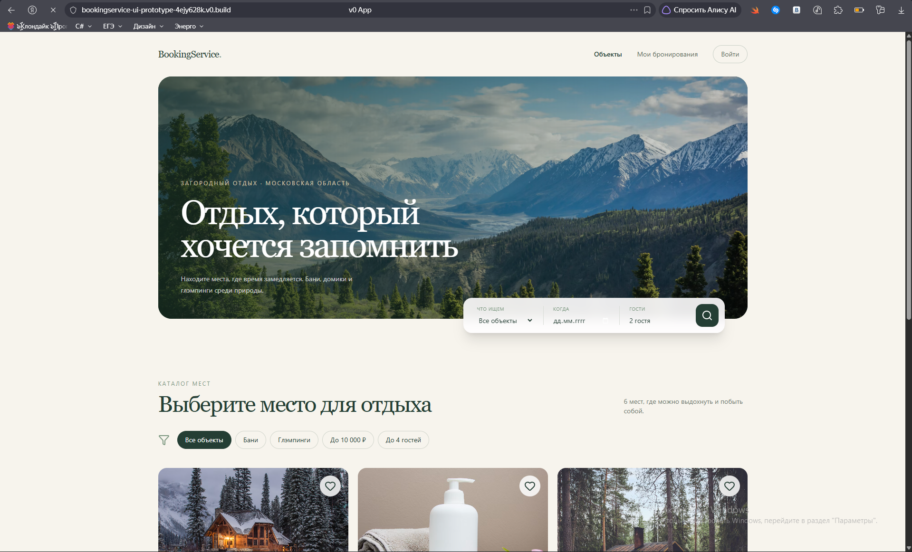
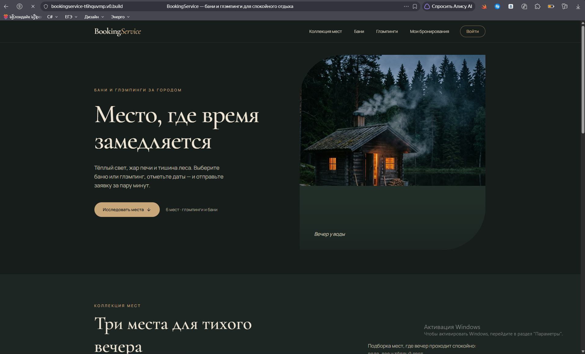
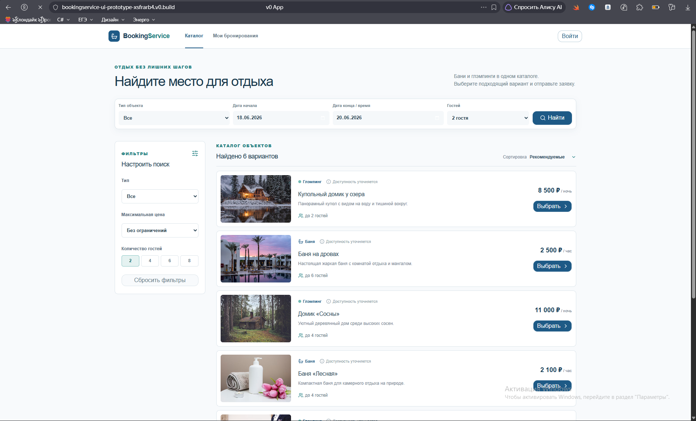

# Сравнение трёх UI-концепций BookingService

## Цель и условия

Для редизайна существующего веб-сервиса бронирования бань и глэмпингов с помощью Text-to-UI-инструмента **v0** подготовлены три независимых визуальных прототипа. Во всех концепциях рассматривались каталог объектов и переход к оформлению бронирования. Исходные промпты сохранены в файлах `concept_1_prompt.md`, `concept_2_prompt.md`, `concept_3_prompt.md`.

Для каждого варианта представлены **два реальных скриншота генерации**: десктопный и мобильный. Оценка ниже основана на видимых экранах. Функциональность кнопок, работа фильтрации, проверка API и поведение формы бронирования в рамках этого сравнения **не тестировались**. Данные, цены, изображения и даты на прототипах демонстрационные, подключение к реальному Backend не подтверждено.

## Концепция №1 — «Природный минимализм»

**Скриншоты:** [десктоп](concept_1_desktop.png), [мобильный экран](concept_1_mobile.png). **Промпт:** `concept_1_prompt.md`.

Вариант использует светлый кремовый фон, тёмно-зелёные элементы, крупный заголовок поверх пейзажной фотографии, поисковую панель и каталог с карточками. На десктопе поисковый блок включает тип объекта, дату и количество гостей; каталог размещён под первым экраном.

**Плюсы:** тёплая и спокойная атмосфера; наглядный поиск уже на главной странице; различимые категории «Бани» и «Глэмпинги»; карточки с фотографиями и возможность дальнейшего развития каталога.

**Минусы:** очень крупный первый экран отодвигает карточки вниз; фотография заснеженных высоких гор не вполне соответствует позиционированию загородного отдыха в Московской области, указанному на прототипе; в показанном мобильном поиске виден только выбор типа объекта, а поля дат и количества гостей, присутствующие на десктопе, отсутствуют. Нужно проверить их доступность и не допустить потери функций на телефоне.

## Концепция №2 — «Премиальный отдых»

**Скриншоты:** [десктоп](concept_2_desktop.png), [мобильный экран](concept_2_mobile.png). **Промпт:** `concept_2_prompt.md`.

Тёмный интерфейс с графитово-хвойной палитрой, бежево-медными акцентами и крупной типографикой. На десктопе первый экран разделён на текстовую область и фотографию деревянной бани в лесу. На мобильном экране секции последовательно располагаются друг под другом; присутствует заметная кнопка «Исследовать места».

**Плюсы:** визуально ближе всего к тематике бань и загородного отдыха; сильный акцент на атмосфере и фотографиях; целостная типографика и палитра; мобильный первый экран сохраняет читаемую композицию; интерфейс выделяется среди стандартных каталогов.

**Минусы:** в пределах первого экрана нет непосредственного поиска по датам и гостям; переход к выбору объекта требует прокрутки или нажатия CTA; длинная вступительная часть задерживает начало практического сценария бронирования; некоторые второстепенные подписи могут быть слишком мелкими или малоконтрастными — нужно проверить по стандартам доступности; на десктопе большой блок изображения и декоративная часть требуют разумного ограничения высоты.

## Концепция №3 — «Удобный каталог»

**Скриншоты:** [десктоп](concept_3_desktop.png), [мобильный экран](concept_3_mobile.png). **Промпт:** `concept_3_prompt.md`.

Светлый интерфейс с синей палитрой: строка поиска по типу объекта, датам и количеству гостей, фильтры сбоку, список горизонтальных карточек, информация о цене и вместимости. На мобильном экране поиск и карточки перестраиваются по вертикали, а фильтры сворачиваются в отдельную кнопку.

**Плюсы:** самый быстрый визуальный доступ к поиску и списку объектов; сразу видны цена, тип, вместимость и действие «Выбрать»; большое внимание уделено фильтрации и сравнению вариантов; компактнее путь от открытия каталога до выбора объекта.

**Минусы:** более утилитарное оформление хуже передаёт атмосферу отдыха; на десктопе некоторые демонстрационные фотографии (например, тропический пейзаж) выглядят чужеродно для лесных бань и глэмпингов; мобильные карточки и двухколоночная форма плотные, нуждаются в проверке размеров интерактивных элементов; указанные в макете даты и результаты поиска являются примером, а не фактической доступностью.

## Сравнительная оценка

Применена заранее выбранная шкала 1–5, где 1 означает слабое соответствие критерию, а 5 — хорошее. Оценки являются экспертной **визуальной** оценкой скриншотов, а не результатом пользовательского исследования. Итог рассчитан как сумма оценки по критерию, умноженной на его вес.

| Критерий | Вес | №1 | №2 | №3 |
|---|---:|---:|---:|---:|
| Понятность пути к бронированию | 30% | 4 | 4 | 5 |
| Мобильная компоновка | 25% | 4 | 5 | 4 |
| Читаемость и контраст | 15% | 4 | 4 | 4 |
| Соответствие тематике отдыха | 15% | 4 | 5 | 2 |
| Возможность адаптации к Next.js + Ant Design | 15% | 4 | 4 | 5 |
| **Взвешенный итог (из 5)** | **100%** | **4,00** | **4,40** | **4,15** |

**Почему не №1:** он близок к выбранному стилю, но демонстрационный мобильный поиск пока менее функционален, а фотография гор неудачна для обозначенной географии. **Почему не №3:** по поиску он удобнее, но сильнее напоминает стандартный сервис подбора жилья, хуже формирует узнаваемый образ бань и глэмпинга.

## Рабочий выбор — концепция №2

Для дальнейшего проектирования **предлагается использовать концепцию №2 «Премиальный отдых»**. Она получила наивысшую экспертную оценку и лучше соответствует желаемому эмоциональному позиционированию сервиса. В обсуждении предпочтение также было отдано второму или первому варианту; окончательное утверждение дизайна остаётся за разработчиком проекта.

Выбор не предполагает дословного копирования прототипа. При дальнейшем редизайне следует сохранить палитру, типографику и визуальную иерархию №2, но добавить элементы, повышающие функциональность:

1. **Поиск как в №1:** тип объекта, даты или время, гости. На мобильном устройстве все параметры должны оставаться доступны.
2. **Практичные карточки как в №3:** цена с единицей измерения, вместимость, тип объекта, статус доступности, кнопка перехода.
3. **Различие сценариев бронирования:** баня — конкретное время начала и окончания, глэмпинг — даты проживания в соответствии с правилами Backend.
4. **Состояния интерфейса:** загрузка каталога, отсутствие результатов, занятый интервал, ошибка сети и необходимость авторизации.
5. **Доступность:** проверить контраст текста, размеры кнопок и полей, работу с клавиатуры и читаемость на узком экране.
6. **Реалистичные изображения и контент:** фотографии мест, соответствующих тематике и региону; не использовать случайные демо-объекты как реальные предложения.

## Что подтверждают материалы

Скриншоты подтверждают, что три независимые стилистические концепции были сгенерированы в v0 и просмотрены в двух размерах экрана. Они **не подтверждают** готовность интерфейса к интеграции, корректность расчёта цены, работу календаря, отсутствие пересечений, поддержку мобильного меню или выполнение действий по кнопкам. Эти требования нужно отдельно описать в User Stories и критериях приёмки, а затем проверить при реализации.
